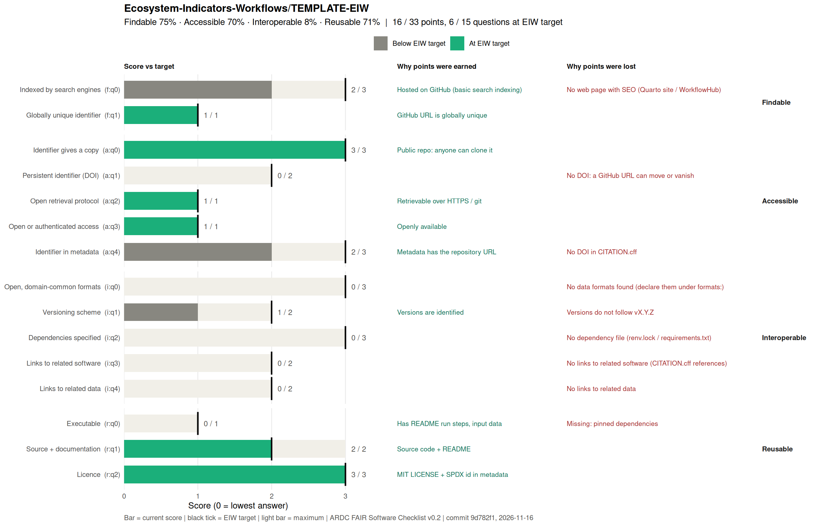

# Ecosystem Indicator Workflow: `{ecosystem-name}`, `{indicator-name}`, `{assessment-name}`


# Project Title

## Overview

Briefly describe the purpose of the project, the problem it addresses,
and the expected outputs.

## Reproducible Section Heads

Use a consistent structure so that readers and automation tools can find
project information quickly.

## Requirements

- [ ] Software dependencies
- [ ] Language/runtime version
- [ ] System/computational environment requirements
- [ ] External data sources or credentials

## Setup

1.  Clone the repository.
2.  Create a virtual environment or package manager environment.
3.  Install dependencies.
4.  Verify the environment works.

## Data

Describe where the data comes from, how it is stored, and whether it is
versioned or generated.

## Workflow

Document the steps needed to reproduce the analysis or pipeline,
including:

- data acquisition
- preprocessing
- modeling or analysis
- reporting or output generation

## Run

``` bash
# Example commands
make
# or
python -m project
```

## Outputs

- [ ] List generated artifacts such as tables, plots, reports, or model
  files, as well as their filepaths in this repository.

## Results

- [ ] Summarize the main findings, key figures, and links to generated
  output files.

## Reproducibility Notes

- [ ] Record relevant details required to reproduce the workflow in this
  repository, including, but not limited to:
  - [ ] Pin dependency versions.
  - [ ] Record the random seed.
  - [ ] Store configuration files in the repository.
  - [ ] Note the exact command(s) used to regenerate outputs.

## Contributing

- [ ] Describe how collaborators can contribute, propose changes, or
  report issues.

## License

- [ ] State the project license and any usage restrictions. Must match
  the `LICENSE` file.
- [ ] Update `LICENSE` with all licenses associated with the repository.

<!-- The results of the FAIR checklist will be automatically added here -->

- [ ] ensure that fair-checklist.yml has been updated with project
  metadata

<!-- FAIR:START -->
## FAIR assessment

[](https://fairsoftwarechecklist.net/v0.2?f=21&a=30112&i=01000&r=023) 

**16 / 33 points · 6 / 15 questions at EIW target** · not yet at EIW minimum

| Principle | Score | EIW target |
|---|---|---|
| Findable | 3 / 4 (75%) | 4 / 4 |
| Accessible | 7 / 10 (70%) | 10 / 10 |
| Interoperable | 1 / 12 (8%) | 12 / 12 |
| Reusable | 5 / 7 (71%) | 6 / 7 |

<details><summary>Gaps to close (9)</summary>

- **f:q0 Indexed by search engines** (2 / 3): No web page with SEO (Quarto site / WorkflowHub)
- **a:q1 Persistent identifier (DOI)** (0 / 2): No DOI: a GitHub URL can move or vanish
- **a:q4 Identifier in metadata** (2 / 3): No DOI in CITATION.cff
- **i:q0 Open, domain-common formats** (0 / 3): No data formats found (declare them under formats:)
- **i:q1 Versioning scheme** (1 / 2): Versions do not follow vX.Y.Z
- **i:q2 Dependencies specified** (0 / 3): No dependency file (renv.lock / requirements.txt)
- **i:q3 Links to related software** (0 / 2): No links to related software (CITATION.cff references)
- **i:q4 Links to related data** (0 / 2): No links to related data
- **r:q0 Executable** (0 / 1): Missing: pinned dependencies

</details>



<sub>Updated 2026-11-16 from commit `9d782f1` by `.fair/fair_check.R`. Edit `.fair/fair-checklist.yml`, not this block.</sub>
<!-- FAIR:END -->
